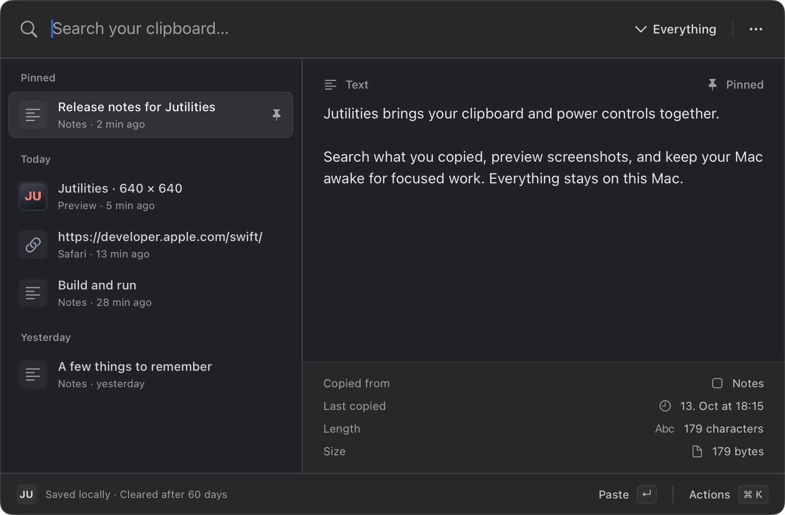
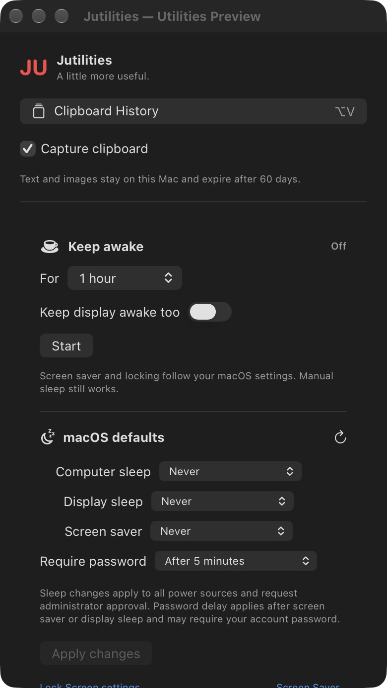

# Jutilities

A native macOS clipboard manager and keep-awake utility, built with SwiftUI and AppKit. The searchable clipboard panel takes inspiration from Raycast, with text and image previews, type filters, pinned items and keyboard actions. The menu bar holds clipboard capture, power settings and launch-at-login controls.



*Preview data.*

Requires macOS 15 or later. Local builds are ad-hoc signed; they are not notarized distribution releases.

## Build and install

Install the full Xcode app, select it as your active developer directory, then install the build tools:

```sh
brew install xcodegen node
npm install -g xcodebuildmcp@2.7.0
git clone https://github.com/julianfbeck/Jutilities.git
cd Jutilities
./scripts/build.sh
./scripts/install.sh
open "$HOME/Applications/Jutilities.app"
```

The build script regenerates `Jutilities.xcodeproj` from `project.yml`, builds Release through XcodeBuildMCP and verifies the app's signature. The install script defaults to `~/Applications`; pass `/Applications` as its first argument to choose that location. Quit Jutilities before replacing an installed version. The installer keeps the previous app bundle as a backup and does not remove your clipboard data.

To inspect the interface without capturing the clipboard or changing power settings:

```sh
open -n "$HOME/Applications/Jutilities.app" --args --preview
```

Preview mode uses sample entries in a separate temporary database. Quit an existing instance first if its global shortcut or menu item would make the preview confusing.

Use `--preview-menu` instead of `--preview` to inspect the menu-bar controls in the same isolated mode.

## Use

| Shortcut | Action |
| --- | --- |
| ⌥V | Open Clipboard History |
| ↑ / ↓ | Select an item |
| Return | Copy and paste into the previous app |
| ⌘Return | Copy only |
| ⌘P | Pin or unpin the selected item |
| ⌘K | Open actions |
| ⌘Delete | Delete the selected item |
| Escape | Close actions or the clipboard panel |

Type to search. The compact, resizable clipboard panel opens at 760 × 500 points. The JU menu groups controls into **Clipboard**, **Keep awake**, and **Sleep & lock settings**. Expand **History & backups** under Clipboard to export or restore history and open its data folder. Expand **Sleep & lock settings** to edit saved macOS defaults. The header's gear menu holds launch-at-login, and Quit stays in the footer while settings scroll. If another app uses ⌥V, open history from the menu bar instead.

Both panels use a translucent native backdrop with a dark tint to keep the controls readable. macOS **Reduce Transparency** switches them to a solid background.

The menu bar uses a compact monochrome Jutilities mark that follows the macOS appearance. A small dot indicates an active keep-awake session; the tooltip also reports that state.

Automatic paste needs **System Settings → Privacy & Security → Accessibility → Jutilities**. Without this optional permission, Jutilities copies the item and you can paste with ⌘V. A locally rebuilt app may need its Accessibility grant renewed.

On first launch, a setup popup offers **Enable Automatic Paste** and **Use Copy-Only**. Enable asks macOS for permission and opens the Accessibility pane.

Enable **Open Jutilities at login** from the gear in the JU menu. The native login item can also be registered by launching the installed app with `--enable-login`:

```sh
open "$HOME/Applications/Jutilities.app" --args --enable-login
```

If Jutilities is already running, quit it before launching with this argument. macOS may require approval in **System Settings → General → Login Items**.

Check registration without opening a window with `Jutilities.app/Contents/MacOS/Jutilities --login-status`.

## Clipboard storage and privacy

History is local, unencrypted SQLite under `~/Library/Application Support/Jutilities`. The app restricts its data directory and database file permissions to your user. It does not upload clipboard history or provide cloud sync.

- Entries, including pinned entries, expire 60 days after their most recent capture or reuse. Copying or pasting an item from Jutilities, or copying the same content again in another app, renews its lifetime.
- Maintenance runs at startup and hourly, and expiry is also enforced while accessing or modifying history. Deletion removes the entry, its stored formats and search data. SQLite secure deletion and checkpointing reduce leftover database content; they are not a guarantee against filesystem snapshots or external backups.
- An automatic recovery database is kept under `Backups` in the app's data directory. Exported backups are kept wherever you save them until you delete them. Restoring a backup validates it and removes expired entries.
- Capture supports text, links, rich text and images, with a 60 MiB limit per capture across stored formats. Files and file promises are not captured.
- Password-manager applications and concealed, transient or automatically generated clipboard types are excluded. These exclusions are best effort: a secret copied by another app without a sensitive marker can still enter history. Pause capture from the menu when needed.

The app does not collect the clipboard content that was present before capture started. Preview mode never monitors or writes the system clipboard.

## Power controls



Start a keep-awake session for 15 minutes, 30 minutes, one hour, two hours or indefinitely. Choose whether to keep the display awake too. These sessions use native IOKit power assertions and stop on expiry, when you press Stop or when you quit the app. They do not alter your saved macOS sleep settings; stopping a session leaves those settings in effect. Screen saver, password delay, manual sleep and lid-close behavior still belong to macOS.

Saved settings change only after **Apply changes**:

- Computer and display sleep use `pmset` with validated time values. Changes apply to all power sources and use the native administrator authorization dialog.
- Screen saver idle time uses the current user's current-host `com.apple.screensaver` preference. Managed settings cannot be changed by Jutilities.
- Password delay uses Apple's `sysadminctl`. When needed, a native secure field requests your current account password for that operation. It is passed to the tool's terminal password prompt, kept out of command arguments, files and logs, and not saved. Jutilities checks the tool's status afterward; if macOS rejects or cannot verify the change, use the provided Lock Screen settings link.

Applying power settings can partially succeed before another selected change fails. Read the reported result and refresh the controls to see what macOS reports.

## Development

Use XcodeBuildMCP 2.7.0 for build and test commands:

```sh
xcodegen generate --spec project.yml
xcodebuildmcp swift-package test --package-path "$PWD"
xcodebuildmcp macos test \
  --project-path "$PWD/Jutilities.xcodeproj" \
  --scheme Jutilities \
  --derived-data-path "$PWD/build/TestDerivedData"
```

Swift Package tests cover the storage and power planning code. The Xcode scheme also includes native app regression tests. CI runs both test paths and a Release app build on macOS. Tests use fixtures and temporary storage; they must not change the developer's actual sleep or lock settings or inspect real clipboard history.

The generated Xcode project is not tracked. Edit `project.yml` and regenerate it with XcodeGen. See [AGENTS.md](AGENTS.md) for contribution constraints.

The app icon's editable source is [Config/AppIcon.svg](Config/AppIcon.svg), designed with Claude Opus 5.5 ([PNG preview](docs/icon.png)). To regenerate the bundled macOS icon, install `librsvg` and run `./scripts/generate-icon.sh`. The generated `Config/AppIcon.icns` is committed, so normal builds do not need the SVG renderer.

## License

[MIT](LICENSE). The UI is independently implemented; Jutilities is not affiliated with Raycast.
